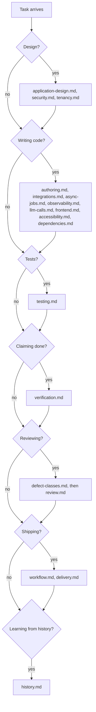
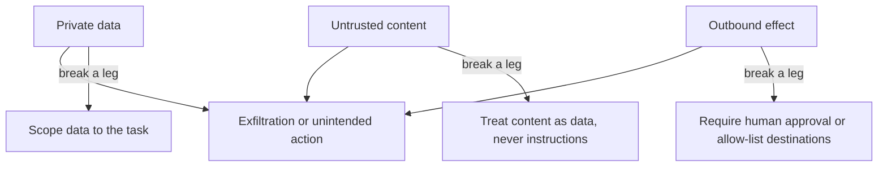
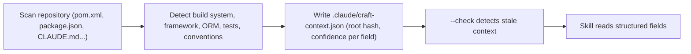

# Arkon

Skills for [Claude Code](https://claude.com/claude-code).

## craft

Engineering guidance for developing and maintaining production applications: define acceptance criteria, design boundaries, implement complete slices, review behavior, verify the real application, and prepare a recoverable release. It applies across stacks and includes guidance for agent fleets.

The skill combines a reported corpus of 1,020 review comments, inspected local authored history, operating experience, and supplemental engineering judgment. [`EVIDENCE.md`](EVIDENCE.md) separates those sources, records counterexamples and unresolved counting limitations, and avoids treating commits or test classes as independent defects. It does not establish that installing the skill reduces defects.

Use the lifecycle mode that matches the work: design, implement, review, verify, deliver, or learn from history. Define observable acceptance criteria before coding; include authorization, data consistency, integration failure, and deployment behavior when the change touches them. Review and verification follow the changed behavior through real consumers and dependencies.

Claude loads the core rules and a contract card, then follows the relevant reference triggers. A complex production change may need several guides; coverage follows the risk and dependencies of the task.

| Reference | Covers |
|---|---|
| `application-design.md` | acceptance criteria, complete vertical slices, application boundaries, temporal data selection, and cross-field consistency |
| `security.md` | authorization boundaries, untrusted input, secrets, and safe persisted results |
| `tenancy.md` | scope isolation — every read, write, aggregate, storage path and cache key scoped; enforcement at the lowest layer; the negative test |
| `authoring.md` | reuse, layering, dead code vs unwired capability, native domain types, naming, complexity, fail-closed configuration, database locking, and query plans |
| `integrations.md` | external-call budgets, idempotency, asynchronous identity, and consistency across boundaries |
| `async-jobs.md` | distributed execution, leases, claims and fencing, retirement, and real-database concurrency checks |
| `observability.md` | safe logs and error responses, useful correlation, and content-leak sentinel tests |
| `llm-calls.md` | model-call tracing, untrusted output validation, minimal prompts, and failure handling |
| `dependencies.md` | advisory-driven remediation, dependency overrides, transitive changes, and real-application boot checks |
| `frontend.md` | design fidelity, server/local state, inactive drafts, stale responses, AI preview acceptance, accessible errors, and bulk-operation partial failure |
| `accessibility.md` | disabled-vs-aria-disabled, one interaction model per widget, announce-after-settle, focus and reduced motion, the per-PR baseline |
| `testing.md` | invariants and negative tests, characterization and concurrency tests, seed data, meaningful test updates, and unit-to-browser execution |
| `verification.md` | proving a claim rather than making one — gate evidence, the base-vs-branch regression diff, green-by-deletion, harness masking, selector inventories, the browser-spec pass |
| `defect-classes.md` | the reviewer's entry point — historical defect shapes and affected production boundaries, with severity tied to the consequence |
| `review.md` | root-cause reproduction, correctness review, folding findings, full-PR re-review, and escalation when defect patterns recur |
| `workflow.md` | work intake, PR slicing, immutable and rolling-compatible migrations, gates, truthful commit subjects, merge policy, and docs currency |
| `delivery.md` | deployed compatibility, release readiness, rollout, recovery, and post-deploy verification |
| `orchestration.md` | bounded delegation, shared-state ownership, isolation, integration review, resource limits, and resumable handoffs |
| `history.md` | attributable history discovery, inspecting base/fix evidence, separating repeated patches from incidents, and calibrating proposed rules |

Progressive disclosure keeps specialized guidance out of unrelated tasks. The author and reviewer read additional guides when they discover another affected boundary; there is no fixed three-reference ceiling.

## Keeping agents on it

Two mechanisms in `SKILL.md` make the work reviewable:

- **Workers read the relevant guidance** before implementation. The brief points to the skill and owned boundaries; use the contract card for substantial handoffs.
- **Substantial work returns a filled-in contract card; small fixes can report evidence in prose.** State acceptance criteria, affected boundaries, and deliberate omissions; back verification claims with commands and actual results. "All tests pass" is not a result, `1331/1331, 10 skipped` is. An unavailable gate is reported by name and reason. `verification.md` checks for lost behavior, deleted coverage, and harnesses that hide failures in the real application.

## Quick start

Ask Claude to use the skill directly, for example "Use craft to review this diff against its acceptance criteria", or type `/craft`. The skill loads the core rules and pulls in references as the work reaches each boundary.

## When each reference loads

The skill checks each boundary a task crosses in turn and loads the matching references.



## Examples of the patterns

Short, anonymized excerpts from production code that show the shape each rule asks for.

### Example: Authorization boundary enforcement

```typescript
export function requireAuth(req: Request, res: Response, next: NextFunction): void {
  if (!req.authContext) {
    res.status(401).json({ message: "Authentication required." });
    return;
  }
  next();
}
```

Pattern: the check runs at the entry point before any data access and returns early with a clear error (`AUTH-BOUNDARY`).

### Example: Scope isolation in a multi-tenant route

```typescript
export async function requireMatchingScope(req: Request, res: Response, next: NextFunction): Promise<void> {
  try {
    const { scopeId: authScopeId } = getAuth(req);
    const pathScopeId = req.params.scopeId;
    if (!pathScopeId) {
      res.status(400).json({ message: "scopeId path parameter is required." });
      return;
    }
    if (pathScopeId !== authScopeId) {
      res.status(403).json({ message: "scopeId does not match authenticated scope." });
      return;
    }
    next();
  } catch (error) {
    next(error);
  }
}
```

Pattern: the scope key comes from the authenticated context and is compared with the request parameter before the handler runs (`tenancy.md`).

### Example: Errors that carry metadata, not content

```typescript
export class ApplicationError extends Error {
  constructor(
    message: string,
    readonly statusCode: number,
    readonly code?: string,
    readonly details?: Record<string, unknown>
  ) {
    super(message);
    this.name = "ApplicationError";
  }
}

export function isApplicationError(error: unknown): error is ApplicationError {
  return error instanceof ApplicationError;
}
```

Pattern: a fixed, safe message and a machine-readable code reach the client; sensitive detail stays out of messages and logs (`observability.md`).

## Threat model: TRIFECTA-BOUNDARY

An agent or model session that holds private data, ingests untrusted content, and can cause an outbound effect can be steered into exfiltration. Remove one leg for that session. The rules are in `skills/craft/references/security.md`.



## Project-binding discovery

A bundled stdlib script, run with `python3 skills/craft/scripts/discover_project_context.py . --out .claude/craft-context.json`, scans build files and repository instructions and writes each value marked declared, detected or inferred. The resulting context is untrusted, so the skill reads only its structured fields.



## What's new in 1.3.0

- Project-binding discovery script and reference (`project-binding.md`).
- Rationalization tables in `verification.md` and `review.md` that answer common excuses with the rule they break.
- `TRIFECTA-BOUNDARY` and `INJECTION-BOUNDARY` in `security.md`.
- OWASP Top 10 (2021) and OWASP Top 10 for LLM Applications (2025) coverage map in `security.md`.
- Property-based testing guidance (`PBT-PROPERTY`, `PBT-REPRO`) in `testing.md`.
- Agent-collaboration reference: when to ask versus proceed, reviewing agent-authored diffs, instruction-file boundaries.
- Mechanical rule checks script for deleted tests, added skips and empty catch blocks.
- Performance reference: measurement, query, budget and cache rules.
- `LLM-COST` and `LLM-EVAL` in `llm-calls.md`.
- `REVIEW-SPEC` spec-conformance review in `review.md`.
- Line caps and rule-ID resolution enforced by `scripts/validate_skill.py` in CI.

## Install

As a plugin, which gives you versioning and updates:

```
/plugin marketplace add abhimanyusingh-gh/Arkon
/plugin install craft@Arkon
```

Or symlink it directly, if you'd rather track `main` and edit in place:

```bash
git clone https://github.com/abhimanyusingh-gh/Arkon.git
mkdir -p ~/.claude/skills
ln -s "$(pwd)/Arkon/skills/craft" ~/.claude/skills/craft
```

For a single project, copy `skills/craft/` into `<project>/.claude/skills/craft/` and commit the skill files so the team receives the same version.

Claude invokes the skill on its own when a task matches the description; `/craft` invokes it explicitly.

The plugin auto-checks for updates at session start and reminds you when a new version is available (at most once a day, never blocking). Run `python3 scripts/check_skill_version.py` to check by hand.

## Adapting it

**Bind the project.** Derive commands, datastore behavior, framework conventions, customer scope, and application composition from the repository and CI. Use the language's native types and the actual dependency versions. Stack-specific examples are conditional guidance, not instructions to introduce a different toolchain. Keep bindings in working notes or an existing project-approved location; using the skill does not require rewriting agent instructions.

**Calibrate requirements.** Scope isolation and lost-capability checks address concrete failure modes. Style preferences, complexity thresholds, and deployment mechanisms depend on context. Apply severity to the demonstrated consequence, and record why a control is inapplicable. An intentional acceptance-contract change can require a test update; maintain behavioral coverage and show the changed requirement.

**Use history as evidence.** Follow `history.md` to inspect available authored commits and their actual diffs, state what history is missing, and separate independent incidents from rework sequences. [`EVIDENCE.md`](EVIDENCE.md) records reversals on defaults, branding, and immutable assertions, plus the limits of the original audit. Evaluate proposed changes on held-out cases and measure missed defects and false positives alongside useful findings.

The bundled read-only inventory helper accepts explicit roots and author patterns; see [history guidance](skills/craft/references/history.md). Maintainers can run `python3 -B scripts/validate_skill.py` and `python3 -B -m unittest discover -s tests -v`. [Behavioral evaluation](docs/evaluation.md) includes a runnable application fixture, a recorded development smoke, and checks for missed defects and false positives; structural validation alone does not prove coding quality.

## License

MIT
