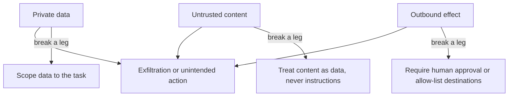

# Examples

Short, anonymized excerpts from production code that show the shape each rule asks for.

## Example: Authorization boundary enforcement

```typescript
export function requireAuth(req: Request, res: Response, next: NextFunction): void {
  if (!req.authContext) {
    res.status(401).json({ message: "Authentication required." });
    return;
  }
  next();
}
```

Pattern: the check runs at the entry point before any data access and returns early with a clear error ([`AUTH-BOUNDARY`](../skills/craft/references/security.md)).

## Example: Scope isolation in a multi-tenant route

```typescript
export async function requireMatchingScope(req: Request, res: Response, next: NextFunction): Promise<void> {
  try {
    const { scopeId: authScopeId } = getAuth(req);
    const pathScopeId = req.params.scopeId;
    if (!pathScopeId) {
      res.status(400).json({ message: "scopeId path parameter is required." });
      return;
    }
    if (pathScopeId !== authScopeId) {
      res.status(403).json({ message: "scopeId does not match authenticated scope." });
      return;
    }
    next();
  } catch (error) {
    next(error);
  }
}
```

Pattern: the scope key comes from the authenticated context and is compared with the request parameter before the handler runs ([`tenancy.md`](../skills/craft/references/tenancy.md)).

## Example: Errors that carry metadata, not content

```typescript
export class ApplicationError extends Error {
  constructor(
    message: string,
    readonly statusCode: number,
    readonly code?: string,
    readonly details?: Record<string, unknown>
  ) {
    super(message);
    this.name = "ApplicationError";
  }
}

export function isApplicationError(error: unknown): error is ApplicationError {
  return error instanceof ApplicationError;
}
```

Pattern: a fixed, safe message and a machine-readable code reach the client; sensitive detail stays out of messages and logs ([`observability.md`](../skills/craft/references/observability.md)).

## Threat model: TRIFECTA-BOUNDARY

An agent or model session that holds private data, ingests untrusted content, and can cause an outbound effect can be steered into exfiltration. Remove one leg for that session. The rules are in [`security.md`](../skills/craft/references/security.md).


