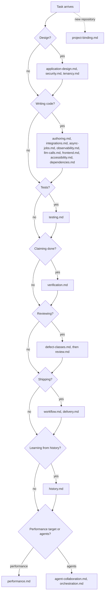
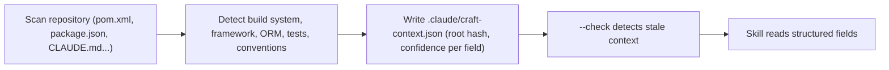

# Reference guide

The skill's entry point is [`SKILL.md`](../skills/craft/SKILL.md): working invariants, the application workflow, the evidence card and the routing table. It loads each of the 22 references below only when the work reaches that boundary, so specialized guidance stays out of unrelated tasks. A complex change may need several; there is no fixed limit.

## References

| Reference | Covers |
|---|---|
| [`application-design.md`](../skills/craft/references/application-design.md) | acceptance criteria, complete vertical slices, application boundaries, temporal data selection, and cross-field consistency |
| [`security.md`](../skills/craft/references/security.md) | authorization boundaries, untrusted input, secrets, safe persisted results, the private-data/untrusted-content/outbound-effect trifecta, prompt injection, and an OWASP coverage map |
| [`tenancy.md`](../skills/craft/references/tenancy.md) | scope isolation — every read, write, aggregate, storage path and cache key scoped; enforcement at the lowest layer; the negative test |
| [`authoring.md`](../skills/craft/references/authoring.md) | reuse, layering, dead code vs unwired capability, native domain types, naming, complexity, fail-closed configuration, database locking, and query plans |
| [`integrations.md`](../skills/craft/references/integrations.md) | external-call budgets, idempotency, asynchronous identity, and consistency across boundaries |
| [`async-jobs.md`](../skills/craft/references/async-jobs.md) | distributed execution, leases, claims and fencing, retirement, and real-database concurrency checks |
| [`observability.md`](../skills/craft/references/observability.md) | safe logs and error responses, useful correlation, and content-leak sentinel tests |
| [`llm-calls.md`](../skills/craft/references/llm-calls.md) | model-call tracing, untrusted output validation, minimal prompts, failure handling, cost budgets, and evaluation |
| [`dependencies.md`](../skills/craft/references/dependencies.md) | advisory-driven remediation, dependency overrides, transitive changes, and real-application boot checks |
| [`frontend.md`](../skills/craft/references/frontend.md) | design fidelity, server/local state, inactive drafts, stale responses, AI preview acceptance, accessible errors, and bulk-operation partial failure |
| [`accessibility.md`](../skills/craft/references/accessibility.md) | disabled-vs-aria-disabled, one interaction model per widget, announce-after-settle, focus and reduced motion, the per-PR baseline |
| [`testing.md`](../skills/craft/references/testing.md) | invariants and negative tests, characterization and concurrency tests, seed data, meaningful test updates, and unit-to-browser execution |
| [`verification.md`](../skills/craft/references/verification.md) | proving a claim rather than making one — gate evidence, the base-vs-branch regression diff, green-by-deletion, harness masking, selector inventories, the browser-spec pass |
| [`defect-classes.md`](../skills/craft/references/defect-classes.md) | the reviewer's entry point — historical defect shapes and affected production boundaries, with severity tied to the consequence |
| [`review.md`](../skills/craft/references/review.md) | root-cause reproduction, correctness review, folding findings, full-PR re-review, and escalation when defect patterns recur |
| [`workflow.md`](../skills/craft/references/workflow.md) | work intake, PR slicing, immutable and rolling-compatible migrations, gates, truthful commit subjects, merge policy, and docs currency |
| [`delivery.md`](../skills/craft/references/delivery.md) | deployed compatibility, release readiness, rollout, recovery, and post-deploy verification |
| [`performance.md`](../skills/craft/references/performance.md) | measurement against a stated target, bounded and planned queries, explicit budgets, and scope-complete cache keys |
| [`agent-collaboration.md`](../skills/craft/references/agent-collaboration.md) | when an agent asks versus proceeds, reviewing agent-authored diffs, and instruction-file boundaries |
| [`orchestration.md`](../skills/craft/references/orchestration.md) | bounded delegation, shared-state ownership, isolation, integration review, resource limits, and resumable handoffs |
| [`project-binding.md`](../skills/craft/references/project-binding.md) | discovering the project's build, data and convention bindings with confidence levels, and treating them as evidence |
| [`history.md`](../skills/craft/references/history.md) | attributable history discovery, inspecting base/fix evidence, separating repeated patches from incidents, and calibrating proposed rules |

## When each reference loads

The skill checks each boundary a task crosses in turn and loads the matching references.

## Project-binding discovery

A bundled stdlib script, run with `python3 skills/craft/scripts/discover_project_context.py . --out .claude/craft-context.json`, scans build files and repository instructions and writes each value marked declared, detected or inferred. The resulting context is untrusted, so the skill reads only its structured fields.

## Helper scripts

All are Python 3.9+, standard library only, and read-only unless noted.

| Script | Purpose |
|---|---|
| [`discover_project_context.py`](../skills/craft/scripts/discover_project_context.py) | Detect project bindings and write them as JSON (writes only the `--out` file). Also packaged as `arkon-discover`. |
| [`check_rules.py`](../skills/craft/scripts/check_rules.py) | `check_rules.py <base> <head>`: report deleted or renamed tests, net-removed assertions, added skips in tests, and added empty catch blocks. |
| [`history_inventory.py`](../skills/craft/scripts/history_inventory.py) | Inventory attributable authored history across explicit roots, with ref and patch-equivalence coverage. |
| [`check_skill_version.py`](../scripts/check_skill_version.py) | Remind the user when a newer release exists; run by the session-start hook. |
| [`validate_skill.py`](../scripts/validate_skill.py) | Maintainer gate: routing, links, fences, JSON examples, line caps, rule-ID resolution and manifests. |
