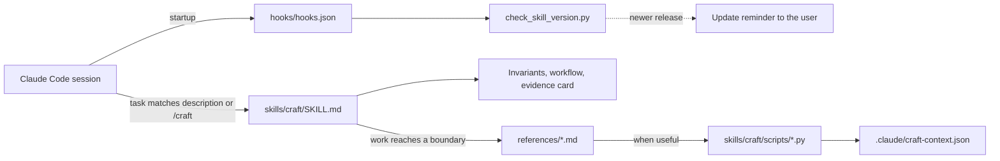
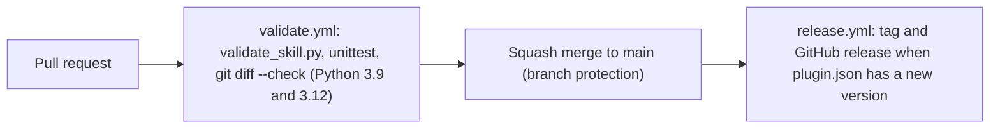

# Architecture

Arkon is a Claude Code plugin marketplace with one plugin, `craft`. The repository root is the plugin root, so Claude Code's standard layout decides where the skill and hooks live.

## Repository layout

```text
Arkon/
├── .claude-plugin/        plugin.json and marketplace.json (name, version, marketplace "Arkon")
├── skills/craft/          the skill Claude Code loads (standard plugin location)
│   ├── SKILL.md           entry point: invariants, workflow, evidence card, routing table
│   ├── references/        one guide per boundary, loaded on demand
│   └── scripts/           stdlib helpers the skill and users run
├── hooks/hooks.json       SessionStart hook: update reminder (standard plugin location)
├── scripts/               maintainer and hook scripts: validate_skill.py, check_skill_version.py
├── tests/                 unittest suite run in CI
├── evals/                 behavioral evaluation fixture
├── docs/                  documentation, evidence and methodology
├── packaging/README.md    PyPI description for arkon-discover
├── pyproject.toml         arkon-discover package, built from skills/craft/scripts
└── .github/workflows/     validate on every PR; release on merge to main
```

The skill, its scripts and the hooks stay where Claude Code discovers them: skills under `skills/`, hooks at `hooks/hooks.json` in the plugin root. Moving them would break plugin installs, the update reminder and the symlink and copy install paths. The standalone package reuses the skill's script through `pyproject.toml` instead of copying it, so there is one source of truth.

## How the skill loads



`SKILL.md` stays at or under 110 lines. Each reference is read only when its trigger matches, so a task pays for the guidance it needs. Rule IDs are defined once, as `**ID — summary.**` or `## ID — summary`, and cited elsewhere by ID.

## Validation and release



`scripts/validate_skill.py` checks frontmatter, routing (every reference has a trigger and every trigger resolves), Markdown links and fences, JSON examples, Python syntax, reference line caps, rule-ID resolution in the verification and review tables, and the plugin manifests. It cannot judge whether guidance is correct; that needs review and the [evaluation protocol](evaluation.md).
